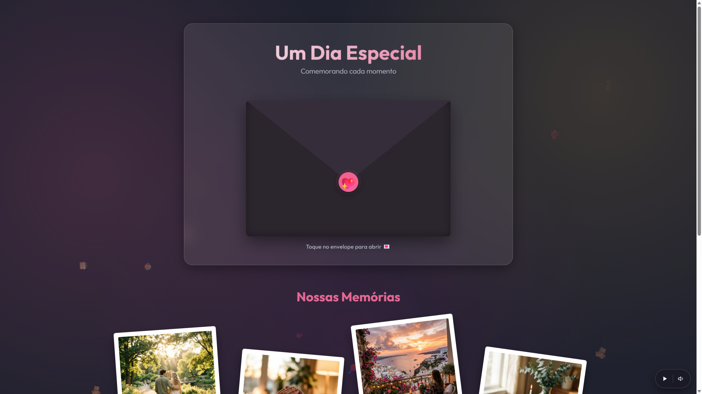
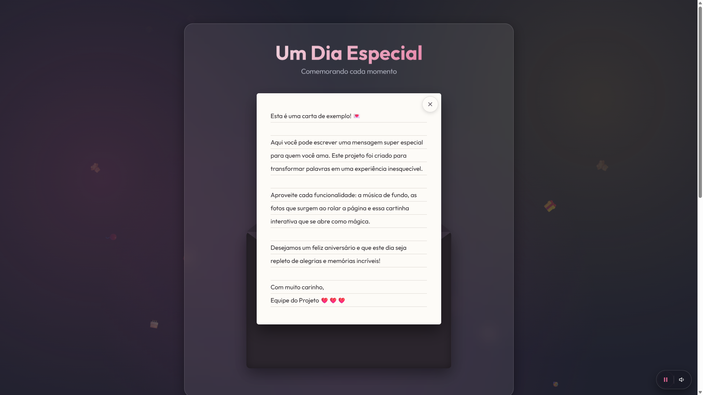
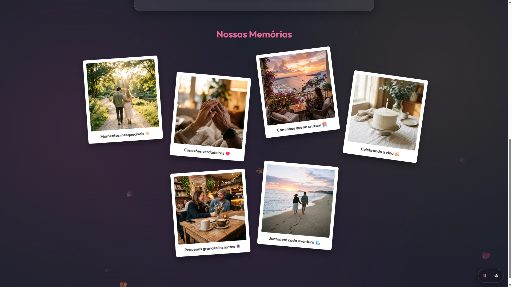
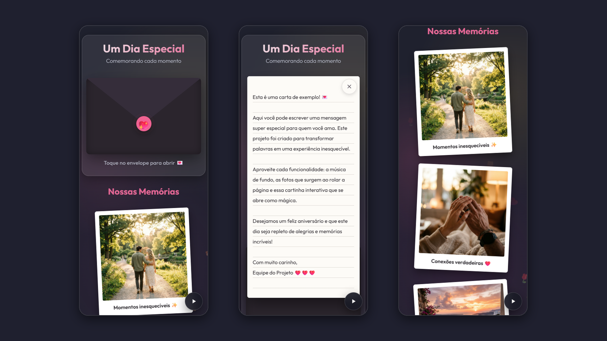

# 💌 Interactive Anniversary Template
> [!IMPORTANT]
> **Nota de Demonstração:** Todo o conteúdo deste repositório (fotos, vídeos, nomes e textos da carta) é meramente ilustrativo e serve apenas como exemplo de preenchimento para o template. Nenhuma informação contida aqui reflete pessoas ou eventos reais.

🚀 **[Visualize o Projeto em Execução](https://interactive-anniversary-template.netlify.app/)**

Este é um projeto de código aberto desenvolvido para criar uma experiência digital memorável e interativa. Ideal para presentear alguém especial com um site elegante, moderno e cheio de carinho.

## 📸 Capturas da Interface

| Envelope fechado e controles de áudio | Carta aberta e mensagem interativa |
| :---: | :---: |
|  |  |

| Mural dinâmico de polaroides | Experiência responsiva em dispositivos móveis |
| :---: | :---: |
|  |  |

## 🌟 Funcionalidades de Destaque

- **💌 Envelope Interativo 3D:** Experiência de abertura em CSS 3D com ajuste automático de altura para nunca sobrepor o cabeçalho em telas grandes ou pequenas.
- **📸 Mural de Polaroides Dinâmico:** Galeria responsiva com revelação em cascata ao rolar (`IntersectionObserver`), inclinação 3D interativa no ponteiro e adaptação limpa para celular.
- **✨ Estética Glassmorphism & Motion Tokens:** Fundo radial animado, transições coordenadas com respeito a `prefers-reduced-motion` e tipografia fluida.
- **🎵 Player de Música com Controle de Volume:** Inicia em volume baixo (`15%`) com entrada suave. No desktop, expande controles na horizontal (`-` / `+`, barra deslizante e silenciar); no celular, mantém apenas o botão discreto de *play/pause* com aviso temporário para ajustar pelo próprio aparelho.
- **📱 Responsividade Total:** Testado de telas pequenas (`320px`) até monitores Full HD (`1920px`), com alvos de toque de `44x44px` e navegação por teclado (`Esc` para fechar).

## 🛠️ Tecnologias Utilizadas

- **Frontend:** HTML5, CSS3 (Vanilla), JavaScript (ES6+).
- **Backend (Opcional/Local):** Python (para edição dinâmica de legendas via Local Dev Protocol).
- **Hospedagem:** Recomendado Netlify ou GitHub Pages.

## 🎨 Como Customizar

1. **Fotos:** Coloque suas imagens em `/imgs/gallery/` e atualize o array `memories` em `/js/main.js`.
2. **Mensagem:** Edite o texto da carta diretamente no `index.html` (div `#editable-letter`).
3. **Música:** Substitua `/music/musica.mp3` pelo seu arquivo de preferência.
4. **Cores:** Ajuste as variáveis `:root` no `/css/style.css`.

## 🚀 Como Executar e Implantar

### Desenvolvimento Local
Para utilizar as ferramentas de automação (como o editor de legendas):
1. Certifique-se de ter o Python instalado.
2. Execute o arquivo `iniciar-servidor-local.bat`.
3. O site abrirá automaticamente com auto-refresh ativado.

### Deploy no Netlify (Recomendado)
1. Crie uma conta no [Netlify](https://www.netlify.com/).
2. Conecte seu repositório do GitHub.
3. Configure o diretório base como `/` (raiz).
4. O Netlify detectará automaticamente o `index.html` e fará o deploy.

---
*Este projeto foi desenvolvido com foco em privacidade, performance e alta disponibilidade emocional. ❤️*
